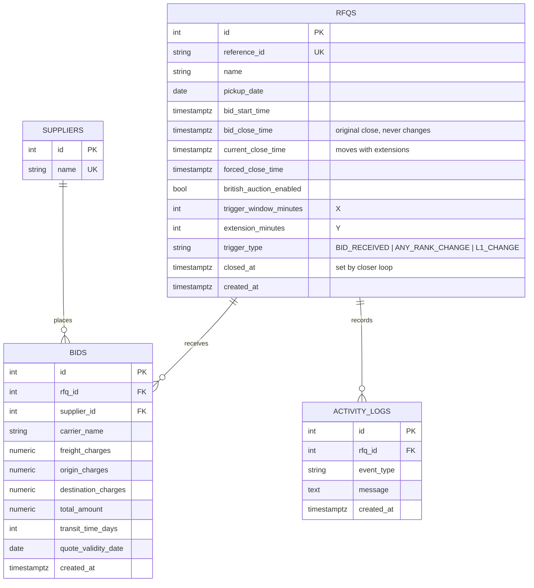
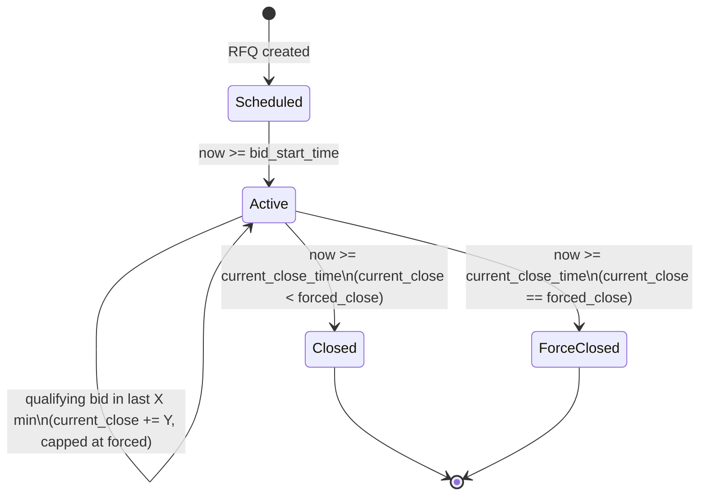

# British Auction RFQ System — Design

## 1. Project overview

A simplified RFQ (Request for Quotation) system where a buyer publishes a freight
requirement and suppliers compete in a **British (reverse) auction**: they submit
quotes openly and keep lowering their price. If meaningful bidding happens close to
the end, the auction is extended automatically, but it can never run past a hard
**forced close time**.

The application has three screens (auction list, auction details with bidding,
RFQ creation), a REST API, and a PostgreSQL database. All auction rules are
enforced on the backend.

## 2. Functional requirements

| Area | Requirement | Where it lives |
|---|---|---|
| RFQ creation | Name, reference ID, bid start, bid close, forced close, pickup/service date, British Auction toggle | `POST /api/rfqs`, `rfq_service.create_rfq` |
| Auction config | Trigger window X, extension duration Y, trigger type (bid received / any rank change / L1 change) | `rfqs` table columns |
| Validation | Forced close > bid close > bid start; extensions never exceed forced close | `schemas.RfqCreate`, `auction_service._extend_close_time` |
| Bidding | Carrier name, freight / origin / destination charges, transit time, quote validity | `POST /api/rfqs/{id}/bids`, `auction_service.submit_bid` |
| Ranking | L1, L2, L3… by total quote amount | `auction_service.compute_ranking` |
| Extensions | Repeated extensions by Y minutes when the configured trigger fires inside the last X minutes | `auction_service.submit_bid` |
| Closing | No bids after close; status Active / Closed / Force Closed | `auction_service.get_auction_status`, `close_expired_auctions` |
| Listing page | RFQ name/ID, current lowest bid, current close, forced close, status | `GET /api/rfqs` |
| Details page | Bids sorted by price, rankings, quote details, X/Y config, activity log with extension reasons | `GET /api/rfqs/{id}` |

## 3. Technology stack

| Layer | Choice | Why |
|---|---|---|
| Frontend | React + Vite | Component model fits three small pages; Vite gives a fast dev server with an API proxy. |
| Styling | Tailwind CSS | Utility classes keep styling next to the markup without a separate design system. |
| Routing | React Router | Three routes: list, details, create. |
| HTTP | Native `fetch` | A 30-line wrapper is enough; no need for Axios. |
| Backend | Python + FastAPI | Request validation via Pydantic, automatic OpenAPI docs at `/docs`, small amount of boilerplate. |
| Validation | Pydantic v2 | Declarative field and cross-field validation (e.g. forced close > close). |
| ORM | SQLAlchemy 2.0 (sync) | Explicit transactions and `SELECT ... FOR UPDATE` support. Sync sessions are simpler to reason about than async ones, and FastAPI runs sync endpoints in a thread pool. |
| Database | PostgreSQL | Relational data (RFQ → bids → suppliers), real transactions, row-level locking, `timestamptz`. |
| Background work | One asyncio task inside the API process | Only job is to record "auction closed" events. See below for why not Celery/Redis. |

**Why no Redis / Celery.** Auction correctness does not depend on a scheduler:
whether bidding is open is computed from timestamps (`now < current_close_time`) on
every request. The only thing that needs to "happen" at closing time is writing the
*Auction closed* entry in the activity log. A small loop in the FastAPI process that
runs every few seconds does that. Adding Redis and a Celery worker would mean two more
services to run and explain for no functional gain at this scale. Section 12 explains
when that would change.

## 4. High-level design

A modular monolith with three backend layers:

- **Routes** (`app/routes/`) — HTTP only: parse input, call a service, map domain
  errors to HTTP status codes.
- **Services** (`app/services/`) — business logic. `rfq_service` handles creating and
  reading RFQs; `auction_service` is the auction engine (validation, ranking,
  extensions, closing).
- **Models** (`app/models.py`) — SQLAlchemy tables.

The frontend is a single-page app that talks to the API over JSON. The details page
polls every 5 seconds to stay current; the countdown ticks locally but is corrected
against the `server_time` returned by the API.

## 5. Architecture diagram


## 6. Database schema



Notes:

- **`bid_close_time` vs `current_close_time`.** The original close is kept for
  reference and display; all logic uses `current_close_time`.
- **Bids are append-only.** A supplier lowering their price creates a new row, so the
  full bid history is preserved. A supplier's *current* bid is their latest row (which
  is also their lowest, because each bid must beat the previous one).
- **`total_amount` is stored**, not computed on every read, so ranking and "lowest
  bid" are simple `ORDER BY` / `MIN` queries. It is always set in one place
  (`submit_bid`).
- Money uses `NUMERIC(12, 2)` to avoid floating-point rounding.
- All timestamps are `timestamptz` and written in UTC.

Indexes:

| Index | Purpose |
|---|---|
| `rfqs.reference_id` unique | Business key, rejects duplicates |
| `suppliers.name` unique | One row per supplier |
| `bids (rfq_id, supplier_id)` | Supplier's previous bid lookup, ranking |
| `activity_logs (rfq_id)` | Activity log for one RFQ |
| `rfqs.closed_at` | Closer loop finds auctions not yet marked closed |

## 7. API design

| Method | Path | Purpose | Main errors |
|---|---|---|---|
| `GET` | `/api/suppliers` | Supplier list for the bid form | — |
| `POST` | `/api/rfqs` | Create an RFQ + auction config | 422 invalid fields, 409 duplicate reference ID |
| `GET` | `/api/rfqs` | Listing: name/ID, lowest bid, current close, forced close, status | — |
| `GET` | `/api/rfqs/{id}` | Details: RFQ, config, status, rankings, all bids, activity log | 404 |
| `POST` | `/api/rfqs/{id}/bids` | Submit a bid | 404, 400 auction not open / bid not lower, 422 invalid fields |

Every read response includes `server_time` so the browser can correct its countdown
for clock differences.

Example bid request:

```json
{
  "supplier_id": 2,
  "carrier_name": "Maersk",
  "freight_charges": "42000.00",
  "origin_charges": "3500.00",
  "destination_charges": "2500.00",
  "transit_time_days": 18,
  "quote_validity_date": "2026-12-31"
}
```

## 8. Auction lifecycle



Status is **derived from timestamps**, not stored:

```python
if now < bid_start_time:         SCHEDULED
elif now < current_close_time:   ACTIVE
elif current_close_time >= forced_close_time:  FORCE_CLOSED
else:                            CLOSED
```

"Force Closed" means the auction was pushed all the way to the forced close time by
extensions, so it ended because of the hard limit rather than because bidding went
quiet.

## 9. Bid submission workflow

```mermaid
sequenceDiagram
    participant UI as React
    participant API as POST /api/rfqs/{id}/bids
    participant SVC as auction_service.submit_bid
    participant DB as PostgreSQL

    UI->>API: bid JSON
    API->>API: Pydantic validation (amounts, dates, required fields)
    API->>SVC: submit_bid(db, rfq_id, data)
    SVC->>DB: BEGIN; SELECT rfq ... FOR UPDATE
    Note over SVC: now = server UTC time (read AFTER lock)
    SVC->>SVC: auction open? supplier exists? lower than own previous bid?
    SVC->>DB: ranking BEFORE
    SVC->>DB: INSERT bid
    SVC->>DB: ranking AFTER
    SVC->>SVC: rank changed? L1 changed? in trigger window?
    SVC->>DB: UPDATE current_close_time (if triggered)
    SVC->>DB: INSERT activity logs
    SVC->>DB: COMMIT (releases lock)
    API-->>UI: 201 + bid, rank, extension info
```

## 10. Extension algorithm

For every accepted bid, inside the same transaction:

1. `previous_close = rfq.current_close_time`
2. `window_start = previous_close - X minutes` — always the **current** close time, so
   after an extension the window moves forward with it.
3. `in_window = window_start <= now < previous_close`
4. Compute ranking before and after inserting the bid. Ranking is a mapping
   `{supplier_id: rank}` built from each supplier's latest bid.
5. Evaluate the configured trigger:
   - `BID_RECEIVED`: always true for an accepted bid.
   - `ANY_RANK_CHANGE`: `ranks_before != ranks_after`.
   - `L1_CHANGE`: `l1_before != l1_after`.
6. If `british_auction_enabled and in_window and trigger_fired`:
   `new_close = min(previous_close + Y, forced_close_time)`.
7. If `new_close > previous_close`, save it and log `AUCTION_EXTENDED` with the reason
   (`"Bid received in last 10 min at 17:55 UTC — close moved 18:00 → 18:05"`). If the
   cap was hit, the log also says the forced close time has been reached.
8. If `previous_close` already equals the forced close, nothing is extended and no
   extension is logged.

Extensions are measured from the current close (`6:00 → 6:05`), as in the assignment
example, not from the bid time.

Worked example (X = 10, Y = 5, trigger = L1 change, forced close 18:12):

| Time | Event | L1 | Close time |
|---|---|---|---|
| 17:40 | A bids 50,000 | A | 18:00 (outside window, no change) |
| 17:52 | B bids 48,000 | B | 18:05 (L1 changed in window) |
| 17:57 | A bids 47,500 | A | 18:10 (window is now 17:55–18:05) |
| 18:01 | C bids 49,000 | A | 18:10 (L1 unchanged → no extension) |
| 18:06 | B bids 47,000 | B | 18:12 (18:15 capped at forced close) |
| 18:12 | — | B | Force Closed, no more bids |

## 11. Forced closing logic

- Creation validates `bid_start < bid_close < forced_close`.
- Extensions use `min(previous_close + Y, forced_close)`, so `current_close_time`
  can never exceed `forced_close_time`.
- Bid validation rejects when `now >= current_close_time` or `now >= forced_close_time`
  (the second check is redundant by construction but kept as a safety net).
- A bid at exactly the close timestamp is rejected (the window is half-open:
  `[start, close)`).

## 12. Assumptions and edge cases

- **Total quote = freight + origin + destination charges.** Transit time and validity
  are shown but do not affect ranking.
- **Ranking uses each supplier's latest bid.** Lowest total = L1.
- **Tie-break:** equal totals are ranked by who submitted that price first (earlier
  `created_at`, then lower bid ID). Being first to a price is rewarded.
- **A supplier may only lower their own bid.** A new bid must be strictly lower than
  that supplier's previous bid. A bid does not have to beat the current L1 — a supplier
  can improve from L4 to L3.
- **Identical re-submissions are rejected** by the "strictly lower" rule, which also
  protects against double-clicks.
- **Freight charges must be > 0**, origin and destination charges ≥ 0, transit time
  ≥ 1 day, quote validity not in the past.
- **Rank change includes a new entrant.** A supplier's first bid adds them to the
  ranking, which counts as a rank change. Likewise the very first bid of an auction
  counts as an L1 change (no L1 → supplier A).
- **Supplier identity is not authenticated.** Suppliers are seeded and chosen from a
  dropdown, which stands in for a logged-in supplier. Authentication is out of scope.
- **Bids are visible to everyone** (British auctions are open by definition).
- **British Auction disabled:** the RFQ still accepts bids between start and close, but
  never extends.
- **Pickup date** is stored and displayed; it is not cross-validated against auction
  dates.
- **Times:** the API only accepts timezone-aware timestamps and stores UTC. The
  browser converts its local `datetime-local` input to UTC before sending, and
  displays in local time.
- **Concurrency:** the RFQ row is locked with `SELECT ... FOR UPDATE` for the whole bid
  transaction. Two bids on the same auction run one after the other; bids on different
  auctions do not block each other. `now` is read after the lock is acquired, so a bid
  that waited for the lock is judged against the time it actually got processed.
- **Closing events** are written by a background loop every 5 seconds, using the close
  time as the event timestamp. If the API is down at close time the event is written
  on the next start; bid acceptance is unaffected because it never relies on the
  loop.
- **Schema management** uses `create_all` at startup instead of Alembic migrations, to
  keep setup to one command.
