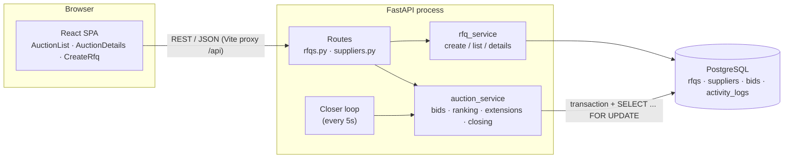
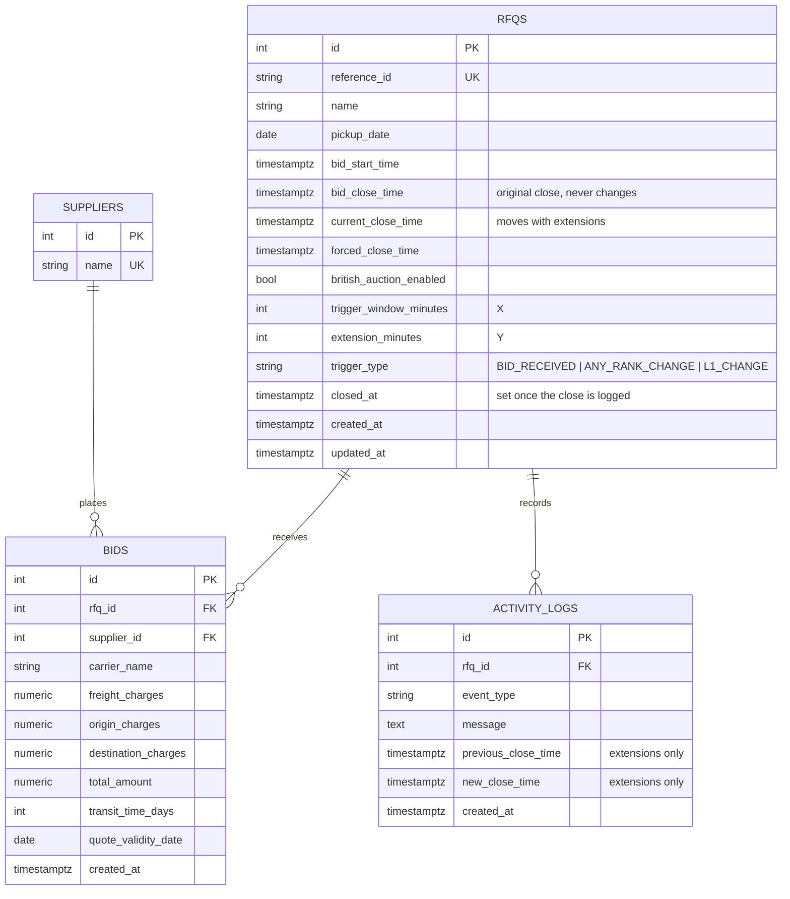

# Design

## Overview

A buyer creates an RFQ with a bid window and auction settings; suppliers submit quotes
and keep lowering them. If qualifying activity happens in the last X minutes before the
close, the close time moves out by Y minutes, but never past the forced close time.

The backend is a single FastAPI app with three layers:

- `routes/`: HTTP only. Parses input, calls a service, returns a response model.
- `services/`: business logic. `auction_service` handles bidding, ranking, extensions
  and closing; `rfq_service` handles creating and reading RFQs.
- `models.py`: SQLAlchemy tables.

Services raise `NotFoundError`, `ConflictError` or `BusinessRuleError`, which `main.py`
maps to 404, 409 and 400.

The React frontend calls the API over JSON. The details page polls every 5 seconds. Its
countdown runs in the browser but is corrected using the `server_time` returned by the
API. The backend's clock is the only one used for validation.

## Architecture



Redis and Celery are not used. Whether an auction accepts bids is computed from its
timestamps on every request, so nothing has to run at closing time for the rules to
hold. The only scheduled work is writing the "auction closed" entry to the activity
log, which a small asyncio loop in the API process does every 5 seconds.

## Database schema

PostgreSQL fits because the data is relational (RFQs, suppliers and bids linked by
foreign keys) and the bid flow needs real transactions and row-level locking
(`SELECT ... FOR UPDATE`) to keep concurrent bids consistent. It also has exact
`NUMERIC` money and `timestamptz`.



- All logic uses `current_close_time`; `bid_close_time` is kept to show the original
  close.
- Bids are append-only. Lowering a price adds a new row, so the full history is kept.
  A supplier's current bid is their latest row.
- `total_amount` (freight + origin + destination) is stored so ranking is a plain
  `ORDER BY`.
- Money is `NUMERIC(12,2)`. Timestamps are `timestamptz` in UTC; each connection is set
  to `timezone=utc`.
- `trigger_type` and `event_type` have CHECK constraints for the allowed values.
- Indexes: unique `rfqs.reference_id` and `suppliers.name`, `bids(rfq_id, supplier_id)`
  for a supplier's previous bid, `bids(rfq_id, total_amount, created_at)` for ranking,
  bid history and the lowest bid per RFQ, `activity_logs.rfq_id`, `rfqs.closed_at`.
- The schema is managed with Alembic migrations (`backend/migrations`). The tests build
  their database from the migrations and fail if a model has no matching migration.
- Auction status is not stored (see below).

## API

| Method | Path | Purpose | Errors |
|---|---|---|---|
| GET | `/api/suppliers` | Suppliers for the bid form | |
| POST | `/api/rfqs` | Create an RFQ with auction settings | 422 invalid, 409 duplicate reference ID |
| GET | `/api/rfqs` | Auction list | |
| GET | `/api/rfqs/{id}` | RFQ, status, rankings, all bids, activity log | 404 |
| POST | `/api/rfqs/{id}/bids` | Submit a bid | 404, 400 auction not open or bid not lower, 422 invalid |

## Auction status

```python
if now < bid_start_time:                       SCHEDULED
elif now < current_close_time:                 ACTIVE
elif current_close_time >= forced_close_time:  FORCE_CLOSED
else:                                          CLOSED
```

Force Closed means extensions pushed the auction all the way to the forced close time.

## Bid submission

`auction_service.submit_bid` runs in one transaction:

1. Lock the RFQ row with `SELECT ... FOR UPDATE`.
2. Read the server time (after the lock, so a bid that waited is judged by when it is
   actually processed).
3. Check the auction is open (`bid_start_time <= now < current_close_time`), the
   supplier exists, the quote validity date is not in the past, and the new total is
   lower than the supplier's previous bid.
4. Compute the ranking, insert the bid, compute the ranking again.
5. Log the bid, plus rank and L1 changes if they happened.
6. Apply the extension rule, then commit.

The row lock makes concurrent bids on the same auction run one at a time. Without it,
two bids could both read a close time of 18:00 and both write 18:05, losing an
extension. Bids on different auctions lock different rows and do not wait on each
other.

## Extension rule

`auction_service._apply_extension`:

1. The trigger window is `[current_close_time - X, current_close_time)`. It is measured
   from the current close, so after an extension the window moves with it and
   extensions can repeat.
2. The trigger depends on the RFQ setting:
   - `BID_RECEIVED`: any accepted bid.
   - `ANY_RANK_CHANGE`: the `{supplier: rank}` map differs before and after the bid.
   - `L1_CHANGE`: the L1 supplier differs before and after the bid.
3. If triggered, `new_close = min(current_close_time + Y, forced_close_time)`, and an
   `AUCTION_EXTENDED` entry is logged with the reason and the old and new close times.
4. If the close is already at the forced close time, nothing changes and nothing is
   logged.

Example with X = 10, Y = 5, trigger = L1 change, close 18:00, forced close 18:12:

| Time | Bid | L1 | Close time |
|---|---|---|---|
| 17:40 | A 50,000 | A | 18:00 (outside window) |
| 17:52 | B 48,000 | B | 18:05 |
| 17:57 | A 47,500 | A | 18:10 (window is now 17:55–18:05) |
| 18:01 | C 49,000 | A | 18:10 (L1 unchanged) |
| 18:06 | B 47,000 | B | 18:12 (18:15 capped at forced close) |
| 18:12 | | B | Force Closed, bids rejected |

## Assumptions

- Ranking uses each supplier's latest bid. Equal totals are ranked by who submitted that
  price first.
- A new bid must be strictly lower than the supplier's own previous bid, but does not
  have to beat L1. This also rejects accidental duplicate submissions.
- Freight must be greater than 0; origin and destination charges can be 0. Transit time
  is at least 1 day. The total must fit the `NUMERIC(12,2)` column (at most
  9,999,999,999.99).
- The pickup date cannot be before the bid close date (compared in UTC), and a quote
  must be valid until at least the pickup date.
- A supplier's first bid counts as a rank change, and the first bid of an auction counts
  as an L1 change.
- A bid at exactly the close time is rejected.
- Suppliers are seeded and picked from a dropdown; there is no authentication.
- With British auction disabled, the RFQ accepts bids between start and close and never
  extends.
- The API only accepts timezone-aware timestamps. The browser converts local input to
  UTC and displays times in local time.
